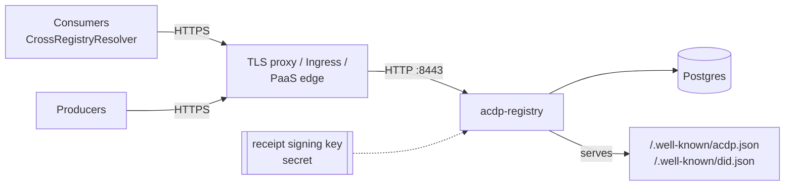

# Deploying the registry in production

This page covers running a registry that other parties depend on: Postgres
storage, registry receipts and lifecycle (retraction) turned on, a signing key
you can rotate, and an upgrade path. It links to the reference pages instead of
repeating them: [CONFIGURATION.md](CONFIGURATION.md) has every key,
[OPERATIONS.md](OPERATIONS.md) has migrations, rate limiting, backup and the
runbooks, and [RECEIPTS.md](RECEIPTS.md) has the key-retention rule.

There are three ready-made shapes. Pick one:

| Shape | File | Use when |
|-------|------|----------|
| Docker Compose (one host) | [`deploy/compose/compose.yml`](../deploy/compose/compose.yml) | One VM with Docker and a TLS proxy in front |
| Kubernetes | [`deploy/kubernetes/registry.yaml`](../deploy/kubernetes/registry.yaml) | A cluster with an Ingress controller and an external Postgres |
| Railway (PaaS) | [`docker/RAILWAY.md`](../docker/RAILWAY.md) | Managed hosting; the [reference deployment](#reference-deployment) runs this way |

A fourth option is the prebuilt binary with your own process manager
([Release binaries](#release-binaries)).

## What "production" means here



A production registry:

- **Stores contexts in Postgres.** SQLite works for a single host, but it has
  no rollback tolerance and no shared rate-limit backend; see
  [Migrations](OPERATIONS.md#migrations).
- **Signs a receipt for every publish** (`acdp-registry-receipts`). This needs
  a registry signing key, and the key needs care: see [The registry signing key](#the-registry-signing-key).
- **Accepts producer-signed retractions and serves lifecycle state**
  (`acdp-registry-lifecycle`, RFC-ACDP-0013). Consumers such as Seam stay
  local-only until a registry advertises this.
- **Is reachable over HTTPS at its bare authority.** The registry's DID is
  `did:web:<authority>`, which resolves to `https://<authority>/.well-known/did.json`.
  Receipts can only be verified when that URL works.

Every shape below sets these profiles, with the env variables named in
CONFIGURATION.md:

```text
ACDP_REGISTRY_STORAGE__BACKEND=postgres
ACDP_REGISTRY_STORAGE__POSTGRES_URL=postgres://…
ACDP_REGISTRY_REGISTRY__AUTHORITY=registry.example.com
ACDP_REGISTRY_REGISTRY__PROFILES=acdp-registry-core,acdp-registry-discovery,acdp-registry-receipts,acdp-registry-lifecycle
ACDP_REGISTRY_RECEIPT__SIGNING_KEY_PATH=/run/secrets/receipt_key_seed   # or …__SIGNING_KEY_SEED_B64
ACDP_REGISTRY_RECEIPT__KEY_ID_FRAGMENT=receipt-key-1
ACDP_REGISTRY_LIFECYCLE__ENABLED=true
ACDP_REGISTRY_AUTH__JWT_SECRET=<openssl rand -base64 32>
ACDP_REGISTRY_AUTH__ANONYMOUS_PUBLIC_READS=true
ACDP_REGISTRY_AUTH__DID_METHODS=did:web,did:key
ACDP_REGISTRY_AUTH__TENANT_HEADER_TRUST=none
```

`registry.profiles` is checked at startup. Listing `acdp-registry-receipts`
without a signing key, or `acdp-registry-lifecycle` without
`lifecycle.enabled = true`, stops the binary at boot instead of letting it
advertise something it cannot do.

**Producer DID methods.** `auth.did_methods` defaults to `["did:web"]`. With
only that default, a `did:key` publish is rejected with `key_resolution_failed`.
Most SDK quickstart producers use `did:key`, so these examples enable both
methods. `did:web` must stay in the list. With auth on, the same list also
controls which DIDs can obtain a token. See
[RECEIPTS.md · did:key producers](RECEIPTS.md#didkey-producers).

**Read posture.** `ANONYMOUS_PUBLIC_READS=true` makes `public` contexts readable
without a credential. A cross-registry consumer needs that to resolve a context
it found by `ctx_id`. `restricted` and `private` contexts still need an
entitled caller. Before you change it, read the
[read-posture note in RAILWAY.md](../docker/RAILWAY.md#required-env-vars).
That note applies to every shape, not only Railway.

## Artifacts

### Container image

```text
ghcr.io/agentcontextdistributionprotocol/acdp-registry:<X.Y.Z>   # one release
ghcr.io/agentcontextdistributionprotocol/acdp-registry:<X.Y>     # rolling patches
```

- The image is built with `storage-pg` only, for `linux/amd64`.
- Pin `X.Y.Z`, or better its digest. `:latest` follows `main`, not the last
  release. [RAILWAY.md](../docker/RAILWAY.md#deploy-the-prebuilt-ghcr-image-recommended)
  explains what each tag guarantees.
- The image runs as uid 1001 and writes nothing to its root filesystem, so a
  read-only root works.

### Release binaries

Every `acdp-registry-server/vX.Y.Z` GitHub Release has prebuilt archives
attached by `.github/workflows/release-binaries.yml`:

```text
acdp-registry-<X.Y.Z>-<target>-<flavor>.tar.gz   (+ .sha256)
SHA256SUMS
```

| `<target>` | Runs on |
|------------|---------|
| `x86_64-unknown-linux-gnu` | Linux x86_64, glibc ≥ 2.35 (Ubuntu 22.04+, Debian 12+, RHEL 9+) |
| `aarch64-unknown-linux-gnu` | Linux arm64, glibc ≥ 2.35 (Graviton, Ampere, Raspberry Pi OS 12+) |
| `aarch64-apple-darwin` | macOS on Apple silicon |
| `x86_64-apple-darwin` | macOS on Intel |

The storage backend is chosen when the binary is compiled, so each target comes
in two flavors:

- `postgres`: the production build, with the same features as the image.
- `sqlite`: a single-file database, for evaluation or a single small host.

Each archive holds the `acdp-registry` binary, the license, the README,
`registry.example.toml` and this guide.

```bash
V=0.5.4; T=x86_64-unknown-linux-gnu; F=postgres
base=https://github.com/agentcontextdistributionprotocol/acdp-registry-rs/releases/download/acdp-registry-server%2Fv$V
curl -fLO "$base/acdp-registry-$V-$T-$F.tar.gz"
curl -fLO "$base/SHA256SUMS"
shasum -a 256 -c SHA256SUMS --ignore-missing
tar xzf "acdp-registry-$V-$T-$F.tar.gz"
"./acdp-registry-$V-$T-$F/acdp-registry"     # reads ACDP_REGISTRY_* and ACDP_REGISTRY_CONFIG
```

A minimal systemd unit for the binary:

```ini
[Unit]
Description=ACDP registry
After=network-online.target postgresql.service
Wants=network-online.target

[Service]
User=acdp
EnvironmentFile=/etc/acdp/registry.env          # the variables above, mode 0600
LoadCredential=receipt_key_seed:/etc/acdp/receipt_key_seed
Environment=ACDP_REGISTRY_RECEIPT__SIGNING_KEY_PATH=%d/receipt_key_seed
ExecStart=/usr/local/bin/acdp-registry
Restart=on-failure
TimeoutStopSec=40
NoNewPrivileges=true
ProtectSystem=strict

[Install]
WantedBy=multi-user.target
```

## Postgres and migrations

- **Version.** CI tests against Postgres 16. The reference deployment runs
  Railway's Postgres 18 image.
- **Connection.** Set `storage.postgres_url` to a libpq-style URL. TLS to the
  database comes from rustls, so add `?sslmode=require` when the database is
  not on a private network. `storage.max_connections` (default 10) is per
  replica, so keep replicas × max below the server's `max_connections`.
- **Database user.** The registry needs to create tables in its database on
  first boot. Give it a database it owns; it does not need superuser.
- **Migrations run at startup, before the listener binds.** They are
  idempotent, so there is no separate migrate step or job. A migration failure
  is a startup failure, which a readiness-gated rollout catches before traffic
  moves.
- **Rolling back one release is supported on Postgres.** Migrations are
  additive, and a binary tolerates a schema newer than its own (0.2.0 and
  later). SQLite has no such tolerance. Details:
  [OPERATIONS.md · Migrations](OPERATIONS.md#migrations).

## The registry signing key

The receipt key is the registry's identity. Every receipt it signs names
`did:web:<authority>#<key_id_fragment>`, and consumers verify against the
public key in `/.well-known/did.json`.

- **Generate** a 32-byte Ed25519 seed: `openssl rand -base64 32`.
- **Store** it as a secret. Either:
  - mount it as a file and point `receipt.signing_key_path` at it (compose
    secret, Kubernetes Secret volume, systemd `LoadCredential`), or
  - inject it as `ACDP_REGISTRY_RECEIPT__SIGNING_KEY_SEED_B64` from a secrets
    manager (the reference deployment uses Doppler).

  Configure exactly one; setting both is a startup error. Surrounding
  whitespace in the file is ignored.
- **Back it up offline**, apart from the database backups. Losing it does not
  invalidate existing receipts: the public half is still in `did.json` as long
  as you keep it configured as a retired key. But you can never sign as that
  key again.
- **Rotate** by moving the old key's public half to `[[receipt.retired_keys]]`
  and choosing a fresh fragment. **Never drop a retired key.** That breaks
  every receipt it signed. See
  [RECEIPTS.md · rotation](RECEIPTS.md#rotation-procedure).
- **Changing `registry.authority` changes the registry's DID.** Receipts
  already issued keep naming the old DID, so treat the hostname as permanent.

`auth.jwt_secret` signs bearer tokens, not receipts. It is checked at boot even
when auth is off (base64, at least 32 bytes, not `changeme`), so set a real one.

## TLS and hostname

Terminate TLS in front of the registry and run it with `registry.tls.enabled =
false`. That is what every shape here does, and it is why each one sets
`registry.allow_public_bind = true`: that setting explicitly allows the
registry to bind a non-loopback address without in-process TLS. In-process
TLS (`[registry.tls]`) also works; see [OPERATIONS.md · TLS](OPERATIONS.md#tls).

- `registry.authority` must be the public hostname, with no scheme. It becomes
  the registry DID, the authority of every minted `ctx_id`, and the host that
  `did.json` describes.
- `https://<authority>/.well-known/acdp.json` and `/.well-known/did.json` must
  reach the registry without any authentication in front of them. A consumer
  resolves both before it trusts anything else.
- Allow request bodies of at least `limits.max_payload_bytes` (1 MiB by
  default) through the proxy.
- **Client IPs.** Behind a proxy, every request arrives from the proxy's
  address. Until `rate_limit.trusted_proxies` lists that proxy, all clients
  share one rate-limit bucket. On a platform whose edge addresses you cannot
  enumerate (Railway, most PaaS), `trusted_proxies` cannot be set safely; put a
  limiter in front if per-client limits matter. See
  [OPERATIONS.md · Rate limiting](OPERATIONS.md#rate-limiting).

## Lifecycle and receipts: what to verify

After the first deploy, check:

```bash
curl -s https://registry.example.com/.well-known/acdp.json | jq '{registry_did, profiles, anonymous_public_reads}'
curl -s https://registry.example.com/.well-known/did.json  | jq '.assertionMethod'
```

- `profiles` should include `acdp-registry-receipts` and `acdp-registry-lifecycle`.
- `assertionMethod` should be `["did:web:registry.example.com#receipt-key-1"]`.

**Lifecycle is a one-way switch in practice.** When the database holds
lifecycle state (any retraction or its events), a boot with
`lifecycle.enabled = false` logs at `ERROR` and exits. Serving that state
without the profile would violate RFC-ACDP-0013 §6. The same applies after
restoring a backup; see
[CONFIGURATION.md `[lifecycle]`](CONFIGURATION.md#lifecycle-acdp-030).

To exercise the whole path the way a consumer does (publish, resolve through
`CrossRegistryResolver` with a verified receipt, retract, resolve again and see
the retraction), run [`tools/live-smoke`](../tools/live-smoke/README.md)
against the instance.

## Health checks

| Endpoint | Meaning | Use for |
|----------|---------|---------|
| `GET /livez` | The process is up. Never touches storage. | Liveness, startup |
| `GET /healthz` | Storage is usable. `503` while the database is not. Body: `{"status","storage","version"}`. | Readiness, deploy gating, uptime monitoring |

Never point liveness at `/healthz`. During a database outage it restarts a
healthy process that a restart cannot fix, and each restart drops the
in-memory webhook queue. `version` reads `X.Y.Z+g<12-hex commit>` for release
images and binaries, which lets you confirm which build is serving.

Prometheus metrics are opt-in under `[metrics]`; see
[OPERATIONS.md · Metrics](OPERATIONS.md#metrics).

## Backups

- **Postgres** holds all state: contexts, receipts, lifecycle events, lineage
  and transparency-log data. Use your platform's scheduled backups or
  `pg_dump`. Restore into an empty database, before the first boot against it.
- **The receipt signing key** is not in the database. Back it up separately
  (see above). A restored database without its key still serves and verifies
  old receipts only while the key stays configured.
- Restoring rolls back the transparency log too. If `[log]` is on, read the
  restore steps first: [OPERATIONS.md · Backup and restore](OPERATIONS.md#backup-and-restore).

## Upgrading

1. Read the target version's section in [UPGRADING.md](UPGRADING.md). Breaking
   0.x changes are listed there, with any config change they need.
2. Take a database backup.
3. Change the pinned version (image tag or binary) and roll out. The new
   process migrates at startup. With one replica, start the new process before
   stopping the old one (`maxSurge: 1, maxUnavailable: 0` in the Kubernetes
   example). Because migrations are additive, the old process keeps serving
   against the migrated schema for the few seconds they overlap.
4. Gate the rollout on `/healthz`, then check that `version` in its body is the
   one you deployed.
5. To roll back, redeploy the previous version. On Postgres that works for one
   release without touching the schema.

Release notes and the per-crate changelogs are on the
[GitHub Releases](https://github.com/agentcontextdistributionprotocol/acdp-registry-rs/releases)
page (`acdp-registry-server/vX.Y.Z`).

## Docker Compose

[`deploy/compose/compose.yml`](../deploy/compose/compose.yml) runs Postgres and
the pinned image on one host. The registry port is published on loopback only,
for a TLS proxy on the same host. The header of the file has the full setup;
in short:

```bash
cd deploy/compose
mkdir -p secrets && chmod 700 secrets
openssl rand -base64 32 > secrets/receipt_key_seed            # back this up
openssl rand -base64 24 | tr -d '/+=' > secrets/postgres_password
printf 'ACDP_AUTHORITY=registry.example.com\nACDP_JWT_SECRET=%s\n' "$(openssl rand -base64 32)" > .env
docker compose up -d
docker compose ps        # registry becomes "healthy" once /healthz answers 200
```

Then point a TLS proxy at `127.0.0.1:8443`. With Caddy, which obtains the
certificate itself:

```text
registry.example.com {
    reverse_proxy 127.0.0.1:8443
}
```

`docker/docker-compose.yml` is a different file: a local demo that builds from
source with auth off. Do not promote it to production.

## Kubernetes

[`deploy/kubernetes/registry.yaml`](../deploy/kubernetes/registry.yaml) holds a
ConfigMap, a Deployment, a Service and an Ingress (ingress-nginx +
cert-manager). Postgres is external, either managed or from your operator of
choice. Create the Secret first; the file ships none:

```bash
kubectl create namespace acdp
kubectl -n acdp create secret generic acdp-registry \
  --from-literal=postgres-url='postgres://acdp:<password>@<host>:5432/acdp_registry?sslmode=require' \
  --from-literal=jwt-secret="$(openssl rand -base64 32)" \
  --from-file=receipt-key-seed=./receipt_key_seed
# replace registry.example.com in the file, then:
kubectl -n acdp apply -f deploy/kubernetes/registry.yaml
kubectl -n acdp rollout status deploy/acdp-registry
```

The Deployment:

- runs one replica as non-root, with a read-only root filesystem
- mounts the receipt key as a file
- uses `/livez` for the startup and liveness probes and `/healthz` for readiness
- pins the image to amd64 nodes

To scale beyond one replica, read the rate-limit note in
[OPERATIONS.md](OPERATIONS.md#rate-limiting) first.

## Reference deployment

`https://registry.agentcontextdistributionprotocol.io` is a public instance run
from this guide. It is on Railway, following
[docker/RAILWAY.md](../docker/RAILWAY.md), with:

- the GHCR image, pinned to a release
- a Railway Postgres service
- receipts and lifecycle on, with anonymous public reads
- the signing key held in Doppler

Use it to test a consumer against a real registry. It is a reference
instance, not a service with an SLA.
